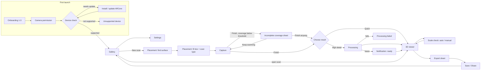

# 02 · User flow and navigation

Reference image: `screens/Main.png` (full flow map).

## Routes

| Route | Screen(s) | Reference images |
|---|---|---|
| `onboarding/{page}` | 3 pages | `Onboarding-1/2/3.png` |
| `permission/camera` | Camera permission | `Permission-Camera.png` |
| `device-check` | ARCore checks + update | `Device-Check.png`, `Device-Unsupported.png` |
| `gallery` | Home | `Gallery-Empty.png`, `Gallery-Light.png`, `Gallery-Dark.png`, `Gallery-Actions.png` |
| `settings` | Settings | `Settings.png` |
| `scan` | Placement → capture → finish (one route, internal state machine) | `Placement-Surface.png`, `Placement-Box.png`, `A-Capture.png`, `Capture-TrackingLost.png`, `Finish-Incomplete.png`, `Finish-Mode.png`, `Scan-Interrupted.png` |
| `processing/{scanId}` | High detail progress / failure | `Processing.png`, `Processing-Failed.png`, `Low-Storage.png` |
| `viewer/{scanId}` | 3D viewer | `A-Viewer.png` |
| `viewer/{scanId}/scale` | Scale check | `Scale-Auto.png`, `Scale-Manual.png` |
| `viewer/{scanId}/export` | Export sheet | `Export.png` |

## Launch logic

- First launch: onboarding → camera permission → device check → gallery. Store `onboardingDone` in DataStore.
- Every launch: re-run the device check silently; only show it if something changed (e.g. ARCore needs an update).
- Notification tap for a finished High detail scan deep-links to `viewer/{scanId}`.
- If the app was killed mid-scan, the next launch offers the **Scan interrupted** sheet.

## Edge and error states (where they appear)

| State | Where | Image |
|---|---|---|
| Low storage | Before Start scan and before High detail | `Low-Storage.png` |
| Processing failed | Processing route | `Processing-Failed.png` |
| Incomplete coverage | Finish on a Full-object scan below threshold | `Finish-Incomplete.png` |
| Interrupted mid-scan | Returning to the app / next launch | `Scan-Interrupted.png` |
| Tracking lost and other live guidance | Capture | `Capture-TrackingLost.png`, `DS-AR.png` |
